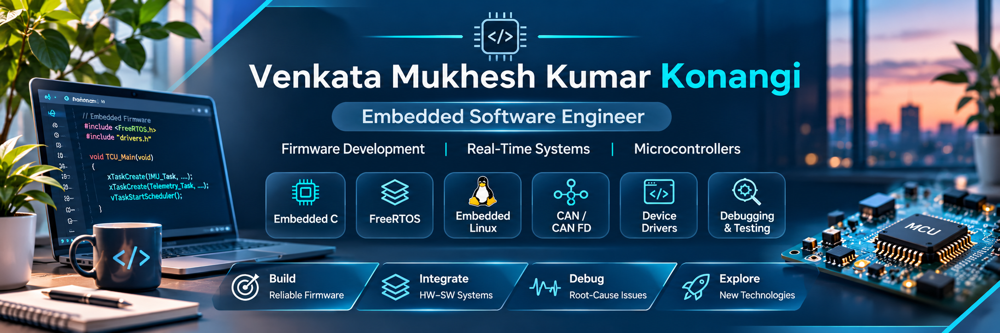

  

# Venkata Mukhesh Kumar Konangi

### Embedded Software Engineer | Firmware | RTOS | Microcontrollers

Building reliable embedded software through firmware development, hardware–software integration, system debugging and continuous learning.

I work across embedded firmware development, real-time systems, communication interfaces, diagnostics and microcontroller-based applications. My engineering interests extend from low-level MCU programming and peripheral drivers to Embedded Linux and system-level development.

- 🔧 Embedded firmware & MCU development
- ⚙️ Real-time systems & FreeRTOS
- 🔌 Communication protocols & peripheral interfaces
- 🐛 System debugging & root-cause analysis
- 🐧 Exploring Embedded Linux & device drivers

---

## ⚡ Technical Stack

### 💻 Programming & Firmware

### ⚙️ RTOS & Microcontrollers

### 🔌 Communication & Interfaces

### 🛠️ Drivers & Hardware

### 🚗 Diagnostics & Embedded Systems

### 🔍 Engineering Tools

---
